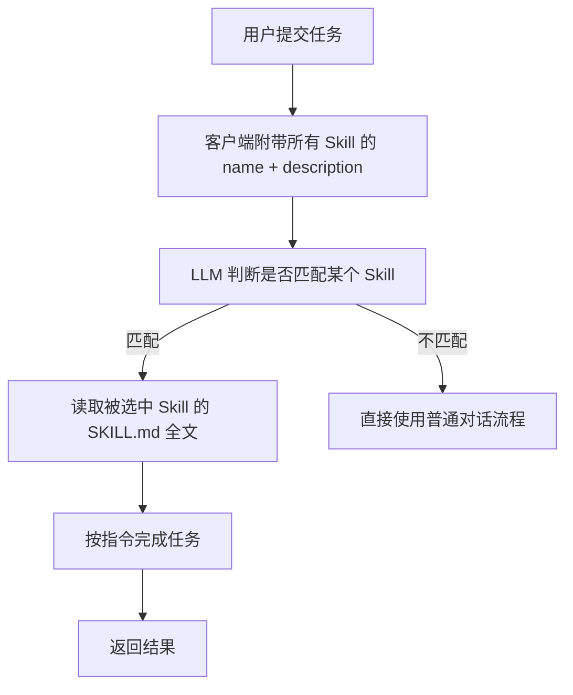

# Agent Skill：从使用到原理

## 一句话总结

**Agent Skill 是一份可复用、可按需加载的“做事说明书”，用来告诉 Agent 遇到某类任务时应该遵循什么流程、规则和输出格式。**它解决的是每次都把长提示词、团队规范和工作步骤复制给模型的问题。

它与 MCP 的关系可以概括为：

> **MCP 负责把数据和外部能力接进来，Agent Skill 负责教 Agent 如何使用这些数据完成任务。**

## 为什么需要 Agent Skill

Agent 能调用工具，却不天然知道你的工作习惯。例如：

- 客服遇到投诉时，应先安抚情绪，不能随意承诺；
- 会议纪要必须按“参会人员—议题—决定”输出；
- 涉及预算时，要额外检查财务合规；
- 某些结果需要固定格式，甚至要直接运行脚本上传。

如果每次都把这些要求复制到 Prompt 中，会出现三个问题：重复、冗长、容易漏。Agent Skill 把稳定的方法沉淀成文件，让 Agent 在需要时自行查阅。

视频介绍的时间线是：

- 2025 年 10 月 16 日，Anthropic 推出 Agent Skills；
- 随后 VS Code、Codex、Cursor 等产品陆续支持；
- 12 月 18 日，Agent Skills 被作为开放标准发布，开始跨平台、跨产品复用。

## 一个 Skill 由什么组成

以 Claude Code 的演示为例，Skill 放在类似下面的目录中：

```text
~/.claude/skills/
└── meeting-summary/
    ├── SKILL.md
    ├── references/
    │   └── finance-handbook.md
    └── scripts/
        └── upload.py
```

核心文件是 `SKILL.md`，通常分为两层：

### 1. 元数据层

使用 YAML Front Matter 描述技能：

```markdown
---
name: meeting-summary
description: 将会议内容整理为参会人员、议题、决定和合规提醒。用户请求会议总结时使用。
---
```

- `name` 是技能名称，演示中要求与技能文件夹同名。
- `description` 告诉系统这个技能负责什么、何时应该使用。
- 元数据会一直提供给模型，相当于技能目录。

### 2. 指令层

正文详细规定 Agent 如何工作，例如：

- 任务目标；
- 执行步骤；
- 判断条件；
- 输出格式；
- 示例；
- 需要读取哪些参考文件；
- 需要运行哪些脚本。

例如会议总结技能可以规定“输出参会人员、议题和决定”，并提供一份输入、输出示例。

## 基本调用流程



以“会议总结”为例：

1. 用户粘贴会议内容，请求总结；
2. 客户端把任务和技能目录一起交给模型；
3. 模型发现任务与 `meeting-summary` 匹配；
4. 客户端读取这个技能完整的 `SKILL.md`；
5. 模型按照其中的结构和规则生成会议纪要。

这里要区分职责：**模型负责判断和生成，Agent/客户端负责读取文件、加载技能与执行工具。**

## 高级用法一：Reference

Reference 是按条件读取的参考资料，例如：

- 财务报销制度；
- 法务合同规范；
- 公司术语表；
- 产品价格表；
- 长篇 SOP。

在 `SKILL.md` 中可以先定义一个触发条件：

> 当会议涉及预算、采购或费用时，读取 `references/finance-handbook.md`，检查金额是否超标，并标注审批人。

执行时的逻辑是：

1. 先读取主指令；
2. 发现会议内容涉及费用；
3. 再读取财务手册；
4. 将合规提醒加入最终纪要。

如果会议只是技术复盘、没有出现与钱相关的内容，财务手册就不会被读取，也不会占用上下文 Token。

**特点：Reference 是要被读进上下文的，因此会消耗 Token；但只有命中条件时才会加载。**

## 高级用法二：Script

Script 用来执行确定性操作，例如：

- 解析 Excel；
- 批量转换文件；
- 调用内部 API；
- 将整理好的结果上传到服务器。

在技能中写明：

> 如果用户要求“上传”“同步”或“发送到服务器”，运行 `scripts/upload.py`，并将最终内容作为输入。

演示中，Agent 先完成会议总结，再运行上传脚本。关键点是：

- 脚本会被执行，但代码正文通常不会被完整读进模型上下文；
- 模型主要关心“怎么运行”和“运行结果”；
- 即使脚本很长，通常也不会像 Reference 那样占用大量上下文。

**Reference 是“读它”，Script 是“跑它”。**

执行脚本前仍应明确说明运行方法、参数和预期输出；如果脚本无法运行，Agent 可能转而检查源码，从而产生额外上下文消耗。

## 渐进式披露机制

Agent Skill 的加载不是一次性全部读入，而是分为三层：

| 层级 | 内容 | 加载时机 | 上下文成本 |
| --- | --- | --- | --- |
| 第一层：元数据 | `name`、`description` | 始终可见，作为 Skill 目录 | 很低 |
| 第二层：指令 | `SKILL.md` 正文 | 用户任务与该 Skill 匹配时 | 中等 |
| 第三层：资源 | Reference、Script、Assets | 指令明确判断需要时 | 按类型不同 |

第三层还可以进一步区分：

- **Reference**：读取文件内容，占用上下文；
- **Script**：执行代码，通常不读取完整源码；
- **Assets**：按需引用图片、模板、数据等资源。

因此可以把它理解为：

> 先看目录 → 命中后读操作手册 → 真正需要时再翻附件或执行脚本。

这种设计既保持技能内容详细，又避免每轮对话都加载全部资料。

## Agent Skill 与 MCP 的区别

Anthropic 对两者关系的概括是：

> **MCP connects Claude to data. Skills teach Claude what to do with that data.**

| 对比维度 | Agent Skill | MCP |
| --- | --- | --- |
| 核心作用 | 教 Agent 按什么流程和规则做事 | 让 Agent 连接数据、系统和外部能力 |
| 主要形态 | Markdown 指令包，可附带资源与脚本 | 独立运行的服务端/协议接口 |
| 擅长场景 | SOP、团队规范、输出模板、领域知识 | API 查询、数据库访问、第三方系统操作 |
| 上下文使用 | 按层级渐进加载 | 工具定义与返回结果进入上下文 |
| 稳定性与权限 | 更适合轻量文件操作和简单脚本 | 更适合复杂、长期运行和强权限控制的集成 |

虽然 Skill 也能在脚本里写连接数据的逻辑，但“能做”不等于“适合做”。稳定、复杂、需要鉴权和权限隔离的数据连接，更适合放到 MCP。

## 应该选哪一个

- 需要查询订单、数据库、CRM 或调用外部系统：**优先 MCP**。
- 已经拿到数据，但需要固定方法处理、判断和输出：**用 Agent Skill**。
- 既要获取外部数据，又要按团队规则处理：**MCP + Skill 组合使用**。
- 只是一次性的轻量文件处理：可以在 Skill 中放小脚本，但不要用 Skill 替代完整的系统集成。

## 实践提醒

1. `description` 决定技能能否被正确发现，要写清“做什么”和“何时使用”。
2. 主指令保持聚焦，大量案例和资料放到 Reference 中。
3. 用 Reference 承载会变化的知识，用 Script 承载可重复的确定性操作。
4. 安装或启用第三方 Skill 前应检查其指令和脚本；脚本虽然可能不被模型逐行读取，但仍会在本机执行。
5. 不要把认证、密钥管理和复杂外部连接都塞进 Skill 脚本，生产场景应优先交给受控的 MCP 或服务端。

## 视频时间轴

- 00:00–01:26 视频内容简介
- 01:26–02:23 Agent Skill 是什么
- 02:23–07:22 Agent Skill 的基本用法
- 07:22–11:22 高级用法：Reference
- 11:22–13:50 高级用法：Script
- 13:50–15:43 渐进式披露机制
- 15:43–17:42 Agent Skill 与 MCP 的区别
