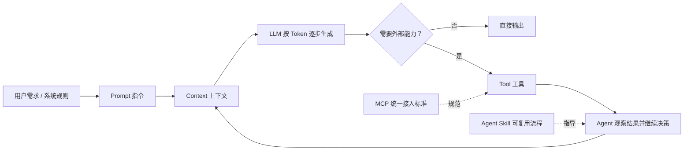

# 从 LLM 到 Agent Skill：AI 核心概念全景

## 一句话总结

现代 AI 应用可以理解成一条逐层搭建的技术链：**LLM 是推理引擎，Token 是处理单位，Context 是每次推理可见的信息，Prompt 是输入指令，Tool 提供外部能力，MCP 统一工具接入，Agent 负责多步规划与执行，Agent Skill 则把稳定、可复用的做事方法交给 Agent。**

视频不讲某个产品，而是用一套统一框架解释这些概念如何衔接，以及为什么它们会一层层出现。

## 核心关系

关键点：模型负责理解和决策，平台负责执行，Agent 负责把“决策—调用—观察—再决策”组织成循环。

## 八个概念

### 1. LLM：语言模型是推理引擎

- LLM（Large Language Model，大语言模型）建立在 Transformer 架构上。Transformer 于 2017 年由 Google 团队提出，论文是 *Attention Is All You Need*。
- 大模型生成内容的方式本质上是一个**文字接龙循环**：根据已有文本预测下一个 Token，把新 Token 追加到输入末尾，再继续预测，直到生成结束标记。
- 它擅长基于训练分布做概率预测，但不会天然拥有实时信息、真实记忆或对外行动能力。

### 2. Token：模型处理文本的最小单位

- 人看到的文字进入模型前，会先由 **Tokenizer** 编码成数字序列；模型输出数字后再被解码回文字。
- 编码通常包含“切分”和“映射”两步：切出的文本片段叫 Token，每个 Token 对应的数字叫 Token ID。
- Token 与“字”或“词”并非一一对应。同一个中文词、英文单词甚至字符，都可能被拆成多个 Token。
- 课程中的经验估算是：1 个 Token 约等于 0.75 个英文单词，或 1.5～2 个汉字。实际数量取决于具体 Tokenizer。

### 3. Context：模型这一次能看见的全部信息

- 模型本身没有持久的对话记忆。聊天程序每次请求时，会把之前的对话历史重新放入输入。
- Context（上下文）是模型执行当前任务时收到的信息总和，可视为模型的**临时工作记忆**。
- 它通常包括：对话历史、当前用户输入、System Prompt、工具列表、工具返回结果，以及模型正在生成的内容等。
- **Context Window（上下文窗口）** 是一次最多能容纳的 Token 数。长文档全塞进去可能超出窗口，也会显著增加成本。
- 处理超长知识库时可用 **RAG**：先检索与问题最相关的片段，再将少量片段提供给模型，而不是一次发送整本资料。

### 4. Prompt：给模型的明确指令

- Prompt（提示词）就是用户或系统交给模型的具体问题、任务与规则。
- 高质量 Prompt 通常更清楚、具体、明确，包含目标、背景、约束、风格和输出格式。
- **User Prompt**：用户在对话中直接输入的问题或要求。
- **System Prompt**：开发者在后台配置的角色、行为边界和长期规则，用户通常看不见，但会持续影响模型行为。
- 视频认为，随着模型理解能力增强，提示词工程的重要性有所下降；但在复杂、专业或要求格式稳定的任务中，清晰指令仍然必要。

### 5. Tool：让模型突破“只会生成文字”

- Tool（工具）本质上是模型可以请求调用的外部函数，例如天气查询、定位、计算、搜索或代码执行。
- 完整调用链包含四个角色：
  1. 用户提出需求；
  2. 平台把问题、可用工具列表和参数说明交给模型；
  3. 模型只负责输出“调用哪个工具、传什么参数”的请求；
  4. 平台真正执行工具，再把结果交回模型归纳。
- 因此，**模型决定调用什么，平台负责实际调用**。工具让模型能够感知并影响外部环境。

### 6. MCP：工具的通用接入协议

- 不同模型平台原本各有工具接入方式，同一工具可能需要为 ChatGPT、Claude、Gemini 分别适配。
- **MCP（Model Context Protocol，模型上下文协议）** 统一了工具接入格式，类似把不同接口收束成同一个“Type-C 标准”。
- 工具开发者按 MCP 规范实现一次，就能被多个支持 MCP 的平台复用，减少重复适配。
- MCP 解决的是**连接标准**问题；具体调用与权限控制仍由客户端、平台或 Agent 执行环境负责。

### 7. Agent：能循环规划和执行任务的系统

普通工具调用通常是一问一答；Agent 则会根据中间结果不断决定下一步。例如“看看天气，下雨就找附近卖伞的店”：

1. 调用定位工具取得经纬度；
2. 根据位置调用天气工具；
3. 发现下雨后，调用店铺搜索工具；
4. 汇总信息，生成最终回答。

这种“思考 → 调用工具 → 观察结果 → 再思考”的闭环让系统具备初步自主规划能力。常见实现思路包括 ReAct、Plan-and-Execute 等；Claude Code、Codex、Gemini CLI 等产品都可放在这一层理解。

### 8. Agent Skill：可复用的做事说明书

Agent 能调用工具，但不一定知道你的私人习惯、团队规范和固定输出格式。每次都把这些规则复制进 Prompt，既冗长又容易遗漏。

Agent Skill 是提前写给 Agent 的可复用文档，通常是一个 Markdown 文件，包含两部分：

- **元数据层**：至少包括 `name` 和 `description`，告诉系统“这个技能叫什么、何时应使用”。
- **指令层**：说明目标、执行步骤、判断规则、输出格式和示例，告诉 Agent“具体该怎么做”。

视频演示的「出门清单」Skill 会先调用定位与天气工具，再依据个人规则判断应带物品，最后按规定格式输出。

一个很重要的机制是**渐进式披露**：

- 启动时只读取技能的 `name` 和 `description`；
- 只有当用户任务与该技能相关时，才加载完整指令；
- 这样既避免每次占用大量 Context，也能让技能内容保持详细。

## 概念对比

| 概念 | 主要回答的问题 | 与其他概念的关系 |
| --- | --- | --- |
| LLM | 谁来理解和生成？ | 核心推理引擎 |
| Token | 文本如何被模型处理？ | 组成 Context、Prompt 和输出的基本单位 |
| Context | 模型这次知道什么？ | 汇总 Prompt、历史、工具结果等信息 |
| Context Window | 模型一次能装多少？ | 限制 Context 的最大 Token 数 |
| Prompt | 这次要模型做什么？ | 被放入 Context 的指令 |
| Tool | 如何获得外部能力？ | 由平台实际执行 |
| MCP | 工具如何统一接入？ | Tool 的通用连接协议 |
| Agent | 如何连续完成复杂任务？ | 循环使用 LLM 与 Tool |
| Agent Skill | 如何稳定复用一套方法？ | 指导 Agent 按固定流程工作 |

## 最值得记住的三个判断

1. **不要把 Agent 当成“更聪明的模型”。** 它是由 LLM、Context、工具调用和执行循环共同组成的系统。
2. **不要把 Context 当成永久记忆。** 每次推理都需要重新组织相关信息，窗口有限且会带来成本。
3. **不要把所有能力都写进 Prompt。** 稳定的流程和规则更适合沉淀成 Skill；外部动态能力更适合封装成 Tool。

## 视频时间轴

- 00:31–03:02 LLM
- 03:02–08:10 Token
- 08:10–11:41 Context
- 11:41–15:11 Prompt
- 15:11–19:20 Tool
- 19:20–21:08 MCP
- 21:08–24:09 Agent
- 24:09–30:44 Agent Skill
- 30:44–32:31 总结
